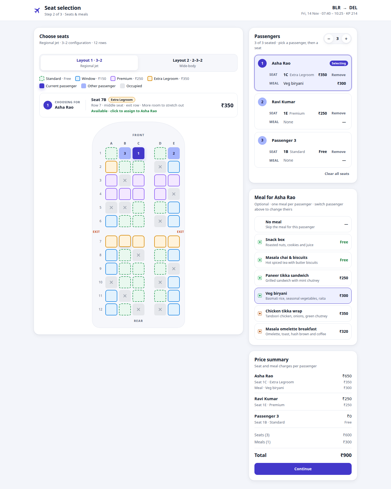
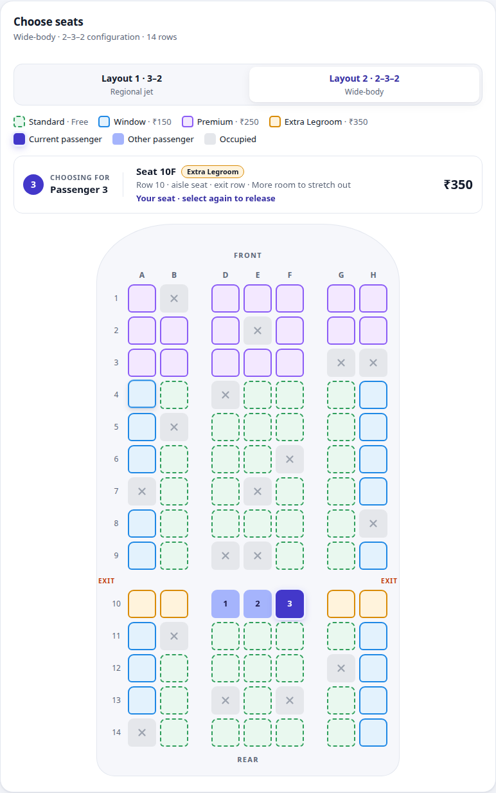
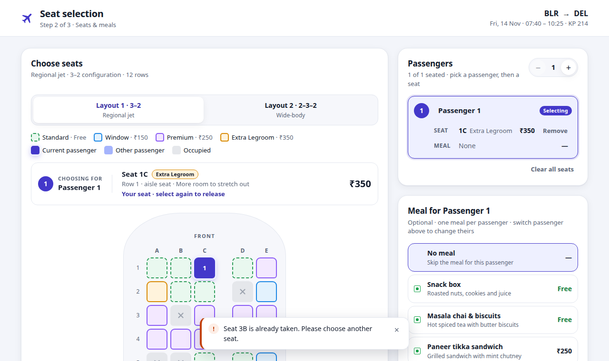
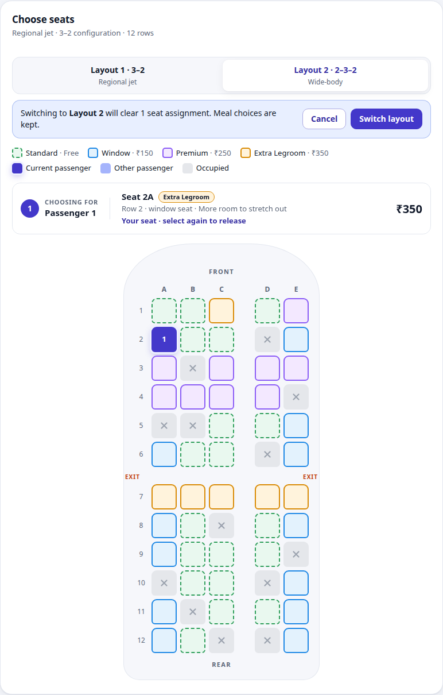
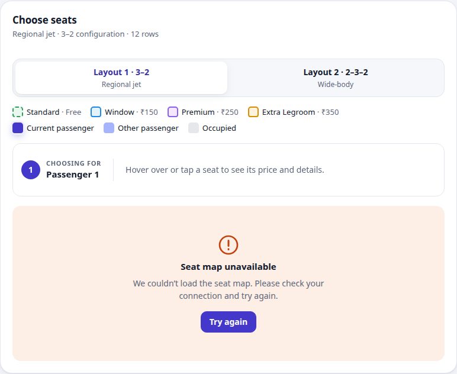
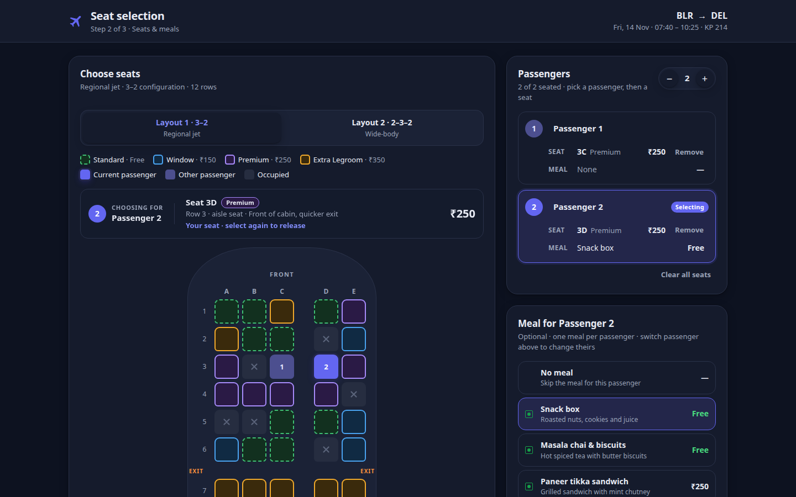
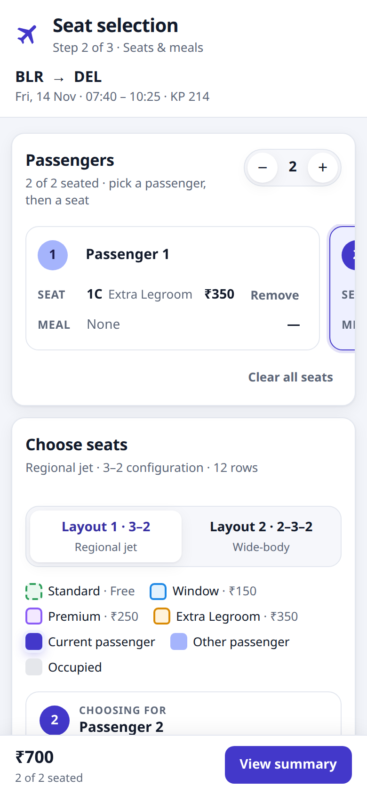
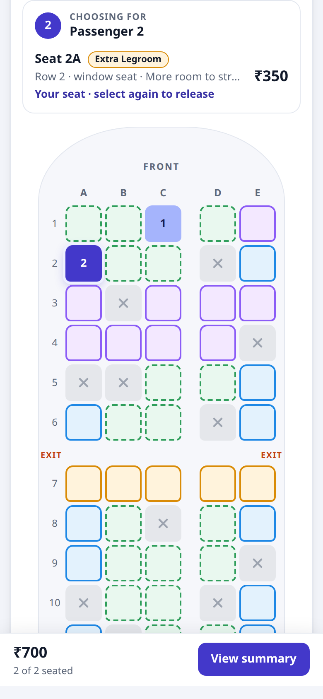
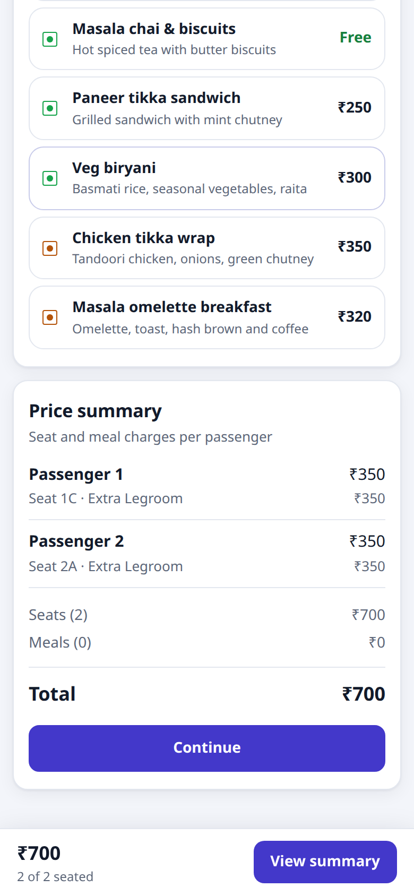

# Flight Seat Selection & Passenger Management

A React app for choosing the number of passengers, switching between two aircraft layouts, assigning one seat per passenger, picking meals, and seeing a live breakdown of the charges.

**Live demo:** _add your GitHub Pages / Vercel URL here_

Built with React 19, TypeScript and Vite. Styling is plain CSS Modules (no UI library). There is no backend: all data is mocked.

## Running locally

```bash
npm install
npm run dev      # development server
npm test         # reducer, selector and pricing unit tests (Vitest)
npm run build    # type-check + production build into dist/
npm run lint     # oxlint
```

Add `?simulateError` to the URL to make the first seat-map request fail. This shows the error state and the retry button.

## Screenshots

### Desktop overview
Three passengers are seated on Layout 1 (3–2). Passenger 1 has a paid meal. The pointer is over seat 7B, so the details panel shows that seat's price, category and position. The summary breaks the ₹900 total down by passenger.



### Layout 2 (2–3–2)
The wide-body cabin, with two aisles and three passengers seated together in exit row 10.



### Feedback and edge cases

| Picking an occupied seat | Switching layout with seats assigned |
| --- | --- |
|  |  |

| Seat map failed to load (`?simulateError`) | Dark mode |
| --- | --- |
|  |  |

### Mobile (390px wide)
On a phone, passengers appear as a swipeable strip at the top. The seats shrink to fit the screen, and a sticky bar at the bottom always shows the total.

<p>
  
  
  
</p>

## Features

- **Passengers.** Choose 1–6 passengers with the stepper. Each passenger has an editable name, and their card shows their seat, meal and prices. Click a card to make that passenger the one choosing a seat.
- **Two layouts.** Layout 1 is 3–2 (`ABC | DE`, 12 rows). Layout 2 is 2–3–2 (`AB | DEF | GH`, 14 rows). Each has row numbers, seat letters, exit-row markers, and a front and rear to the cabin.
- **Seat states.** Seats are shown as available (coloured by price), free (dashed border), occupied (grey with ×), the current passenger's seat (solid indigo with their number), or another passenger's seat (light indigo with their number). A legend explains each state.
- **Pricing.** Seats come in four categories: Standard ₹0, Window ₹150, Premium ₹250 and Extra Legroom ₹350. The sample data from the brief (1A–2B) is used as-is. Hover over or focus a seat, or tap it on mobile, to see its price, category and position.
- **Meals (bonus).** Each passenger can pick one meal. Some meals are free and some are paid, and meal charges are included in the total.
- **Summary.** Each passenger's seat and meal charges are listed with subtotals for seats and meals and a grand total, and the total updates immediately. On phones, a sticky bar at the bottom always shows the total.
- **Feedback.**
  - Messages explain invalid actions: picking an occupied seat, or a seat that belongs to another passenger.
  - A message also confirms when seats are released.
  - The seat map has loading (skeleton) and error (retry) states.
  - Before a layout switch clears seats, you're asked to confirm.
- **Responsive and accessible.**
  - The seats scale to fit the screen using CSS container queries, so even the 7-across cabin fits a 360px phone without horizontal scrolling.
  - Seats are real buttons with descriptive `aria-label`s and work with the keyboard.
  - Dark mode follows the system setting.

## Project structure

```
src/
  data/            mock data: layouts, seat categories, seat-map builder, meals
  services/        fetchSeatMap(): mock async API with simulated latency/failure
  state/           bookingReducer (all business rules), selectors, provider + useBooking hook
  components/
    ui/            reusable building blocks: Panel, Button, Stepper, SegmentedControl
    seat-map/      presentational cabin: SeatMap, SeatButton, skeleton/error states
    seat-selection/container that connects state to the map + LayoutSwitcher, SeatLegend, SeatDetails
    passengers/    PassengerPanel, PassengerCard, PassengerAvatar
    meals/         MealSelector
    summary/       PriceSummary, MobileTotalBar
    feedback/      Toast
  utils/           currency formatting, className helper
```

**The layout config drives everything.** A layout is a plain object (`src/data/layouts.ts`) that lists:

- its seat blocks (`[['A','B','C'], ['D','E']]`)
- its exit and premium rows
- any category overrides
- which seats are occupied

`buildSeatMap()` turns this into rows of seats with a category, price and position (window, middle or aisle). The seat map's CSS grid is built from the same blocks, with an aisle between each block. Adding a third aircraft means adding one config object. No component changes are needed.

## State management

All booking state lives in one `useReducer`. It is shared through React Context (`BookingProvider` and the `useBooking()` hook). Redux would add ceremony without benefit at this size, and keeping every rule in a single pure reducer makes it easy to unit-test.

```ts
interface BookingState {
  layoutId: LayoutId;
  seatMap: { status: 'loading' } | { status: 'ready'; data: SeatMap } | { status: 'error'; message: string };
  passengers: Passenger[];                    // { id, number, name }
  activePassengerId: string;                  // who is currently choosing
  seatByPassenger: Record<string, string>;    // passengerId → seatId  (single source of truth)
  mealByPassenger: Record<string, string>;    // passengerId → mealId
  notice: Notice | null;                      // feedback message shown as a toast
}
```

The state stores only the minimum needed. Everything else is derived in memoised selectors (`src/state/selectors.ts`):

- `selectPassengerBySeat`: the reverse index (seatId → passengerId), used to colour the map.
- `selectBookingSummary`: one line per passenger (seat, meal, prices, subtotal), plus the seat total, meal total, grand total and counts.

Totals are never stored, only derived, so they can't drift out of sync. They update on every select, change or remove.

**Loading the seat map.** The provider fetches the seat map whenever `layoutId` changes, or when the user presses retry. When a response arrives, the reducer checks it is for the layout that is currently selected. A slow response for a layout the user has already left is ignored.

## Seat assignment logic

Both rules from the brief are enforced by the shape of the data and by one reducer action:

1. **One seat per passenger.** Assignments are keyed by passenger id, so a passenger cannot have two seats. Assigning a new seat simply overwrites the old one.
2. **One passenger per seat.** `SELECT_SEAT` checks the seat's current holder before assigning it.

When the user clicks a seat, `SELECT_SEAT(seatId)` does the following:

| Situation | Result |
| --- | --- |
| Seat map not loaded yet | Ignored |
| Seat is occupied | Rejected, with the message “Seat 2D is already taken…” |
| Seat already belongs to the active passenger | The seat is released (click again to remove it) |
| Seat belongs to another passenger | Rejected, with the message “Seat 1C is already assigned to Asha…” |
| Seat is available | Assigned to the active passenger. Their previous seat, if any, is freed. |

After a passenger's **first** seat is assigned, the app moves on to the next passenger who has no seat yet, so a group can be seated with consecutive clicks. When a passenger *changes* seat, they stay selected.

Other actions that affect seats:

- **Switching passengers** (`SET_ACTIVE_PASSENGER`) changes only `activePassengerId`, so earlier assignments are kept.
- **Remove** (`REMOVE_SEAT`) clears that passenger's seat and makes them the active passenger, ready to pick a new seat.
- **Lowering the passenger count** removes passengers from the end of the list. Their seats and meals are released and a message lists the freed seats.
- **Switching layout** (`CHANGE_LAYOUT`) clears seat assignments, because seat ids belong to a particular aircraft. If any seats are assigned, the UI asks for confirmation first. Meal choices are kept.

Occupied seats use `aria-disabled` rather than `disabled`. They look and behave as unavailable, but clicking one still reaches the reducer, so the user is told why it can't be selected.

## Deployment

**GitHub Pages:** push to `main`, then in the repo go to *Settings → Pages → Source* and select **GitHub Actions**. `.github/workflows/deploy.yml` runs the tests, builds the app and publishes `dist/`.

**Vercel:** import the repo. It detects Vite automatically (build command `npm run build`, output folder `dist`).

`vite.config.ts` uses `base: './'`, so the same build works under a GitHub Pages sub-path and at the root of a Vercel domain.

## Assumptions

- The brief describes Layout 2 as “three groups of three seats”, but its example labels (`A B D E F G H`) show seven seats in a 2–3–2 arrangement. This app implements the 2–3–2 arrangement as labelled.
- Occupied seats and prices are mock data. The seat map is loaded through a fake async service so the app has realistic loading and error states.
